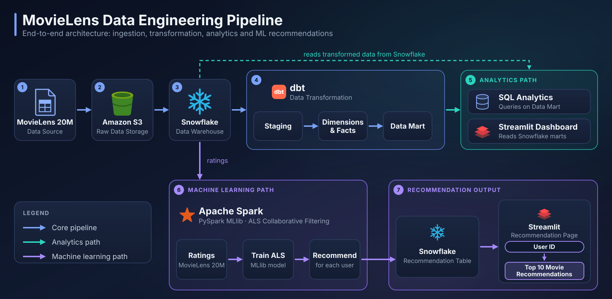
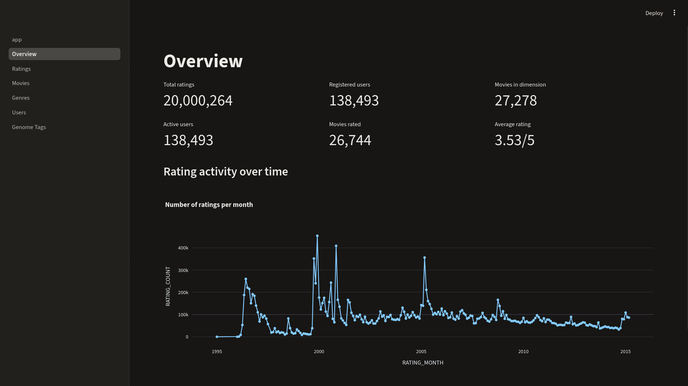
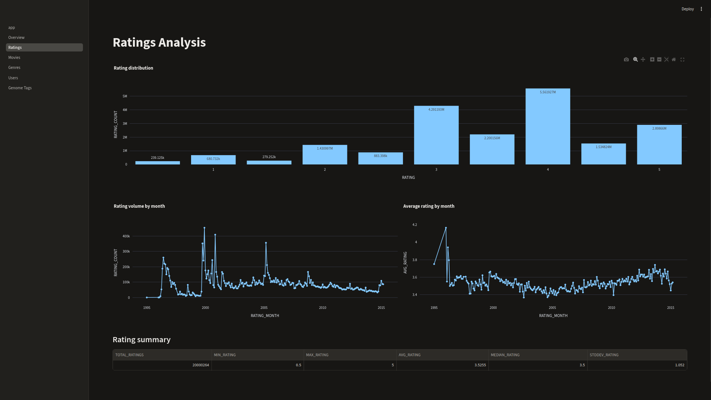
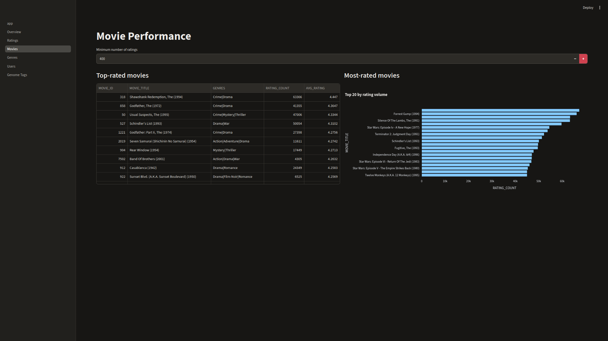
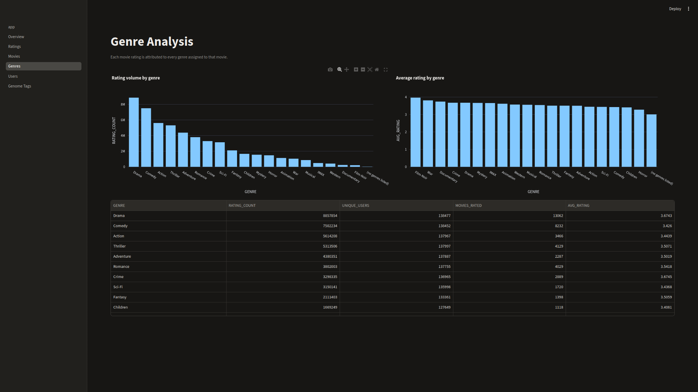
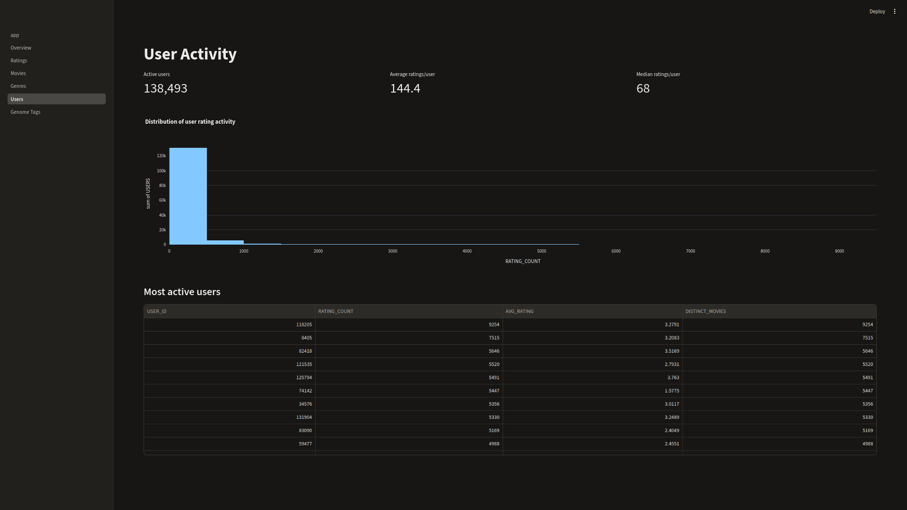
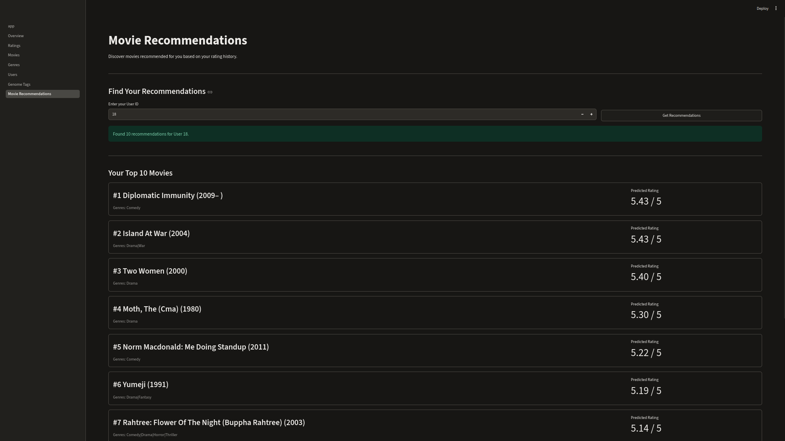

# MovieLens Data Platform

An end-to-end data platform built on the **MovieLens 20M dataset**, combining data engineering, analytical modeling, interactive visualization, and personalized movie recommendations.

## Architecture



## Project Overview

The platform transforms raw MovieLens data into an analytics-ready data warehouse and a personalized movie recommendation system.

It consists of three main components:

- **Data Engineering:** Cloud storage, data warehousing, transformation, and data quality.
- **Analytics:** SQL-based analysis and interactive dashboards.
- **Machine Learning:** Personalized movie recommendations using collaborative filtering.

## Technology Stack

| Area | Technologies |
|---|---|
| Cloud Storage | Amazon S3 |
| Data Warehouse | Snowflake |
| Data Transformation | dbt |
| Analytics | SQL |
| Dashboard | Streamlit, Plotly |
| Machine Learning | Apache Spark, PySpark MLlib (ALS) |
| Programming | Python |

## Data Engineering

- Stored the raw MovieLens dataset in Amazon S3.
- Used Snowflake as the central data warehouse.
- Built modular dbt models following a layered transformation approach:
  - Staging models
  - Dimension and fact models
  - Data marts
- Implemented data quality tests, reusable macros, seeds, and snapshots.

### dbt Lineage


## Analytics Dashboard

Built an interactive Streamlit dashboard connected to Snowflake to explore MovieLens data.

The dashboard includes:

- Overview of the dataset.
- Ratings analysis.
- Movie and genre insights.
- User behavior analysis.
- Genome tags exploration.
- Personalized movie recommendations.

### Dashboard Screenshots

**Overview**



**Ratings Analysis**



**Movies**



**Genres**



**Users**



**Genome Tags**


## Machine Learning Recommendation System

Implemented a collaborative filtering recommendation system using **Apache Spark MLlib ALS**.

- Trained the model using explicit user ratings.
- Generated personalized Top 10 movie recommendations.
- Stored recommendation results in Snowflake.
- Integrated the recommendations into Streamlit.
- Enabled users to retrieve recommendations by entering their User ID.

### Recommendation Interface



### Model Results

| Metric | Result |
|---|---:|
| Users with recommendations | 138,493 |
| Total recommendations generated | 1,384,930 |
| Recommendations per user | 10 |

## Project Structure

```text
movielens-data-platform/
├── analyses/       # SQL analytical queries
├── dashboard/     # Streamlit application
├── docs/           # Architecture and screenshots
├── macros/         # Reusable dbt macros
├── ml/              # ALS training and recommendation scripts
├── models/          # dbt staging, dimensions, facts, and marts
├── seeds/           # dbt seed files
├── snapshots/       # dbt snapshots
├── tests/           # Custom dbt tests
│
├── dbt_project.yml
├── packages.yml
└── README.md
```

## Getting Started

### Prerequisites

- Python
- dbt with the Snowflake adapter
- Access to an AWS S3 bucket
- Snowflake account
- Apache Spark

### Install Dependencies

Install the dashboard dependencies:

```bash
pip install -r dashboard/requirements.txt
```

Install dbt dependencies:

```bash
dbt deps
```

Configure your Snowflake credentials locally before running the application.

### Run the Dashboard

```bash
streamlit run dashboard/app.py
```

### Run dbt Models

```bash
dbt build
```

The machine learning scripts are available in the `ml/` directory and require a configured Spark environment and Snowflake connection.

## Dataset

**MovieLens 20M Dataset** by GroupLens Research, University of Minnesota.

The dataset includes movie ratings, movie metadata, tags, and genome relevance scores.

---

**Project Focus:** Data Engineering · Analytics · Machine Learning